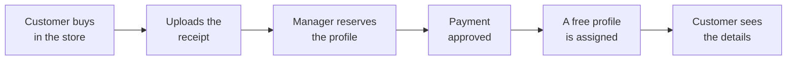
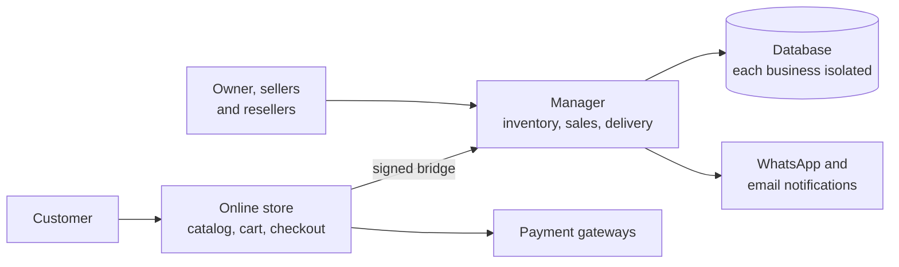

# Account manager + Store

> The account and profile inventory, sales, payments and delivery of a digital
> services business in one panel, connected to its own online store: the customer
> buys, the payment is approved and the manager assigns a free profile from the
> inventory, with its details ready to use.

**Status:** in production ·
**Proprietary system** by Kusarive Solutions LLC ·
[Versión en español](README.md) ·
[Presentation page](https://rjblancos.github.io/gestor-cuentas-showcase/) ·
**[Download the presentation as PDF](presentacion/Gestor-de-cuentas-y-Tienda-presentacion.pdf)** (16 slides, in Spanish)

---

*The main dashboard: where the money comes from, today's sales, cost and real
profit, upcoming renewals and the available inventory. Demo install with made-up
data. The interface is in Spanish.*

## The problem

Businesses that sell access to digital services by profile — one shared account
split among several people, each with their own profile and PIN — usually run on
spreadsheets and chats: which profile is free, who bought it, when it expires, who
paid and who didn't. Mistakes cost money: a profile sold twice, a forgotten renewal,
a customer who paid and waits hours for their details.

The manager keeps all of that in a web panel and connects it to the business's own
store: the customer buys on their own, uploads the payment receipt and gets their
details as soon as the payment is approved.

## What it does

- **Account and profile inventory.** Each account with its email, password, expiry,
  cost and PIN-protected profiles. Free, taken, reserved and expiring at a glance.
- **Four-step sale.** Customer → service → account or profile → payment and
  delivery, always from the real inventory.
- **Connected online store.** Catalog with images, prices and live stock, cart,
  checkout with receipt, order lookup and an app installable on a phone. The catalog
  is edited in the manager and the store mirrors it.
- **Payments to verify.** Each order arrives with its receipt in view; by the time
  it is approved, its stock was already reserved.
- **Automatic delivery from inventory.** The manager finds a real free profile,
  assigns it and the customer sees the details on their private order page.
- **Expiry and renewals.** Alerts for what is expiring, one-step renewal and a
  forecast of renewals for the next 7 and 30 days.
- **Real profit per currency.** Sales, cost and profit kept per currency, never
  mixed, and payment methods ranked by income.
- **Sellers and resellers.** Each seller works in an isolated space with their own
  customers, inventory and sales; resellers buy at their own price.
- **Gift cards and codes**, physical products and bundles, in the same catalog.
- **Under your brand:** your name, logo, colors, app icons and local currency.

## How an order gets delivered

## Benefits

| For the business | |
|---|---|
| **Nothing is sold twice** | Stock is reserved at purchase and assigned from the real inventory. |
| **Get paid and deliver without chasing data** | Receipt, order and delivery in one place. |
| **Know whether you are making money** | Real sales, cost and profit, per currency and per day. |
| **No renewal slips through** | Alerts and a forecast of what is expiring. |

| For its customers | |
|---|---|
| **Buy at any hour** | No need to message to ask for prices or availability. |
| **Get their details right away** | On a private order page. |
| **From a phone** | The store installs as an app. |

## Screenshots

| Payment to verify | Automatic delivery |
|---|---|
|  |  |

| Account and profile inventory | Sales |
|---|---|
|  |  |

| Master catalog | New sale |
|---|---|
|  |  |

| The store | Product page |
|---|---|
|  |  |

| Checkout | Delivered order |
|---|---|
|  |  |

| The manager on a phone | The store on a phone |
|---|---|
|  |  |

Demo install: made-up platforms, customers and sales.

## Architecture

The store and the manager talk through a bridge signed with a timestamp: neither one
accepts an order that does not come from the other.

## Technical guarantees

| Area | What the system guarantees |
|---|---|
| **Inventory** | The profile is reserved when the order is created and delivery is idempotent: an order is never delivered twice. |
| **Bridge** | Store and manager communicate with an HMAC signature and a timestamp. |
| **Payments** | With automatic gateways, the notice signature is verified and the payment is queried again: it is only marked paid if amount and currency match. Repeated notices are discarded. |
| **Private orders** | Each order page opens with a signed link that cannot be guessed from the order number. |
| **Isolation** | Each seller works in their own space; their customers, inventory and sales never mix with anyone else's. |
| **Access** | Second factor, attempt limits and a notice for every sign-in. |
| **Money** | Sales, costs and profit kept per currency; different currencies are never added together. |

## Built with

| Language | Where | Approximate size |
|---|---|---|
| **PHP** | Manager and store: inventory, sales, delivery, bridge, payments and screens | 26,900 lines |
| **CSS** | The interface of both | 4,700 lines |
| **JavaScript** | Interaction, notifications and installable app | 2,100 lines |
| **SQL** | Storage, with each business isolated | — |

GitHub's language bar only measures the files in this repository, which is
documentation.

## Results

Real figures from the two installs in production, in Central America, read on
27-Oct-2026. In production since May 2026.

- **Over 1,000 sales** recorded (1,062).
- **Over 3,000 customers** (3,099).
- **440 accounts** in inventory.
- **14 sellers** with their own space and sales.

## Want your own manager and store?

We set them up with your brand, currency and domain, load your inventory and catalog,
and leave your store selling.

Rafael Blanco, for Kusarive Solutions LLC

- Web: [kusarive.us](https://kusarive.us)
- Email: info@kusarive.us
- WhatsApp: [+1 407 337 0061](https://wa.me/14073370061)
- Presentation: [16-slide PDF](presentacion/Gestor-de-cuentas-y-Tienda-presentacion.pdf) (in Spanish)

© 2026 Kusarive Solutions LLC. See [LICENSE](LICENSE).
