# Gestor de cuentas + Tienda

> El inventario de cuentas y perfiles, las ventas, los cobros y la entrega de un
> negocio de servicios digitales en un solo panel, conectado a su propia tienda en
> línea: el cliente compra, el pago se aprueba y el gestor le asigna un perfil libre
> de su inventario, con sus datos listos para usar.

**Estado:** en producción ·
**Sistema propietario** de Kusarive Solutions LLC ·
[English version](README.en.md) ·
[Página de presentación](https://rjblancos.github.io/gestor-cuentas-showcase/) ·
**[Descargar la presentación en PDF](presentacion/Gestor-de-cuentas-y-Tienda-presentacion.pdf)** (16 diapositivas)

---

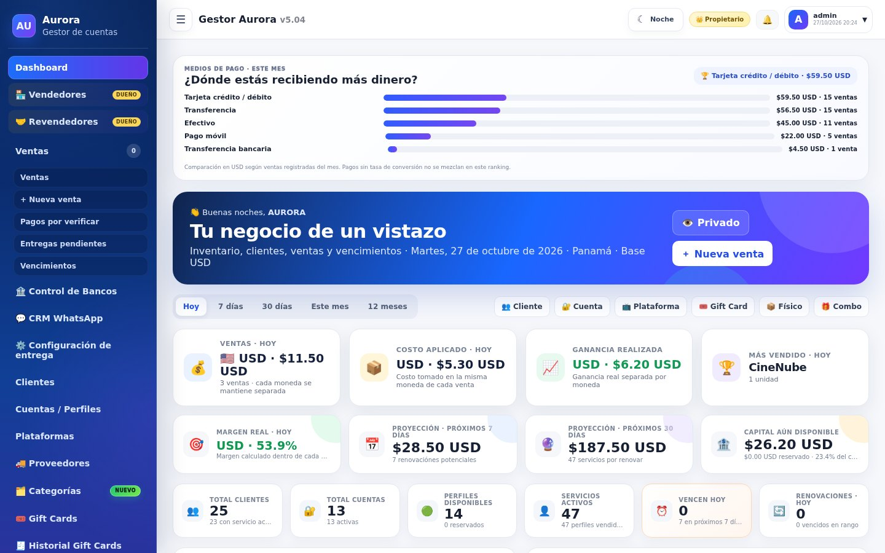

*El panel principal: de dónde entra el dinero, ventas, costo y ganancia real del
día, proyección de renovaciones y el inventario disponible. Instalación de
demostración con datos inventados.*

## Qué resuelve

Quien vende acceso a servicios digitales por perfiles —una cuenta compartida entre
varias personas, cada una con su perfil y su PIN— suele llevar el negocio en hojas de
cálculo y chats: qué perfil está libre, a quién se le vendió, cuándo vence, quién pagó
y quién no. Los errores cuestan dinero: un perfil vendido dos veces, una renovación
olvidada, un cliente que paga y espera horas por sus datos.

El gestor lleva todo eso en un panel web y lo conecta a una tienda propia: el cliente
compra solo, sube su comprobante y recibe sus datos en cuanto se aprueba el pago.

## Qué hace

- **Inventario de cuentas y perfiles.** Cada cuenta con su correo, contraseña,
  vencimiento, costo y perfiles con PIN. Se ve de un vistazo qué está libre, ocupado,
  reservado o por vencer.
- **Venta en cuatro pasos.** Cliente → servicio → cuenta o perfil → cobro y entrega,
  siempre desde el inventario real.
- **Tienda en línea conectada.** Catálogo con fotos, precios y stock en vivo, carrito,
  compra con comprobante, consulta del pedido y app instalable en el celular. El
  catálogo se edita en el gestor y la tienda lo refleja.
- **Pagos por verificar.** Cada pedido llega con su comprobante a la vista; al aprobarlo,
  el stock ya estaba reservado para ese pedido.
- **Entrega automática desde el inventario.** El gestor encuentra un perfil libre real,
  lo asigna y el cliente ve sus datos en la página privada de su pedido.
- **Vencimientos y renovaciones.** Avisos de lo que vence, renovación en un paso y
  proyección de lo que se renovará en los próximos 7 y 30 días.
- **Ganancia real por moneda.** Venta, costo y ganancia separados por moneda, sin
  mezclarlas, y medios de pago ordenados por lo que más ingresa.
- **Vendedores y revendedores.** Cada vendedor trabaja en su propio espacio, aislado,
  con sus clientes, inventario y ventas; los revendedores compran con precio propio.
- **Gift cards y códigos**, productos físicos y combos, en el mismo catálogo.
- **Con tu marca:** nombre, logo, colores, iconos de la app y moneda de tu país.

## Cómo se entrega un pedido

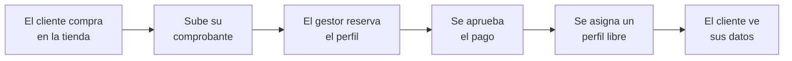

## Beneficios

| Para el negocio | |
|---|---|
| **Nada se vende dos veces** | El stock se reserva al comprar y se asigna desde el inventario real. |
| **Cobras y entregas sin perseguir datos** | El comprobante, el pedido y la entrega están en el mismo sitio. |
| **Sabes si estás ganando** | Venta, costo y ganancia real, por moneda y por día. |
| **No se te pasa una renovación** | Avisos y proyección de lo que vence. |

| Para sus clientes | |
|---|---|
| **Compran a cualquier hora** | Sin escribir para preguntar precio ni disponibilidad. |
| **Reciben sus datos al momento** | En una página privada de su pedido. |
| **Desde el celular** | La tienda se instala como app. |

## Capturas

| Pago por verificar | Entrega automática |
|---|---|
| 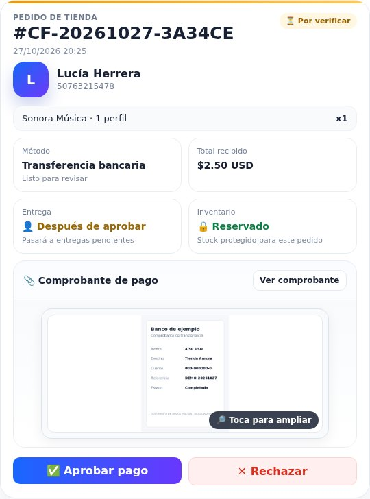 | 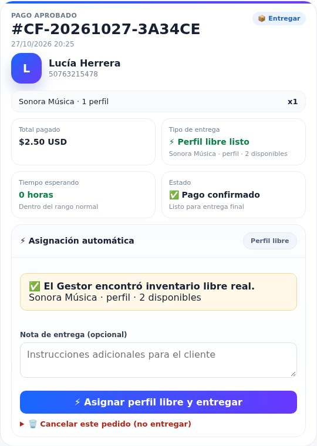 |

| Inventario de cuentas y perfiles | Ventas |
|---|---|
| 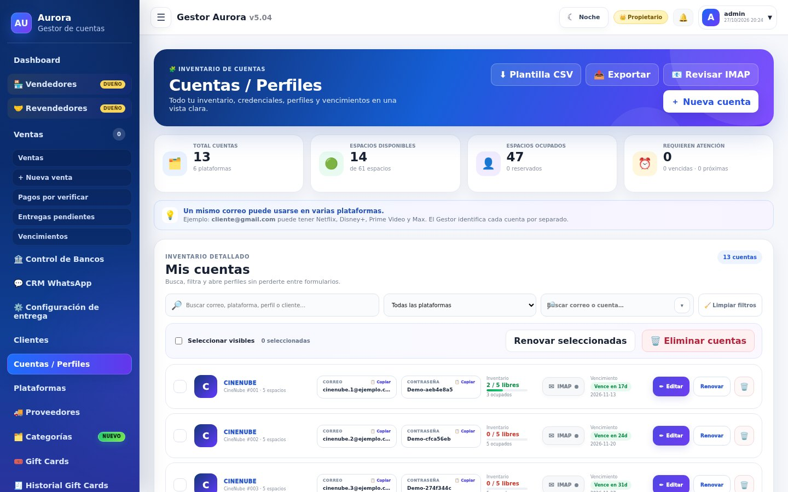 | 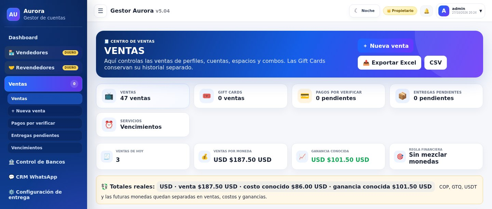 |

| Catálogo maestro | Nueva venta |
|---|---|
| 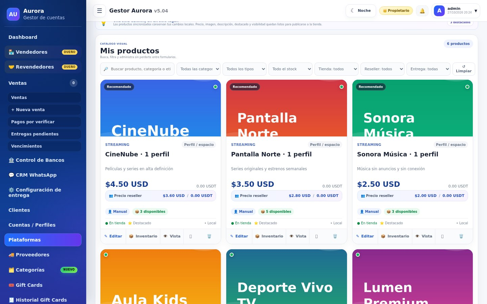 | 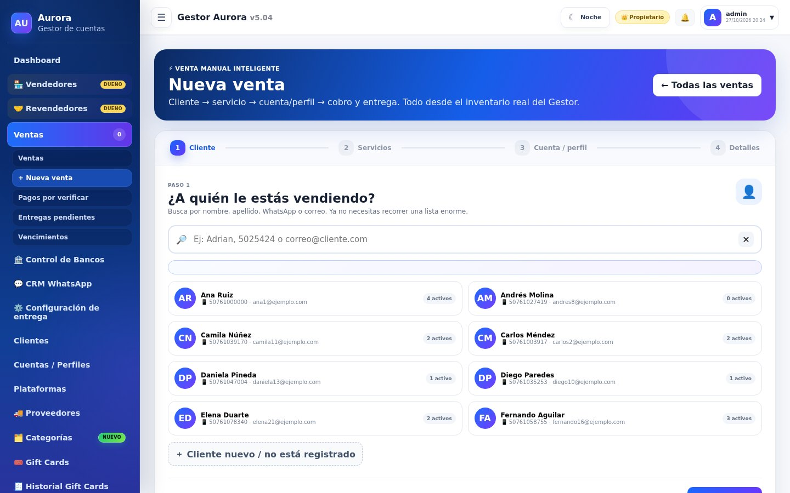 |

| La tienda | Ficha de producto |
|---|---|
| 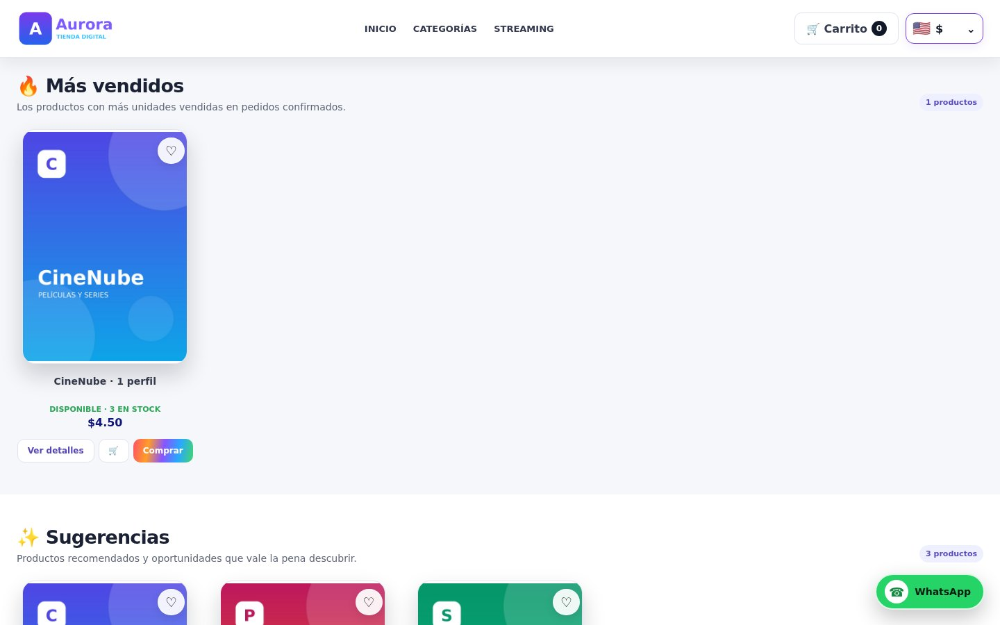 | 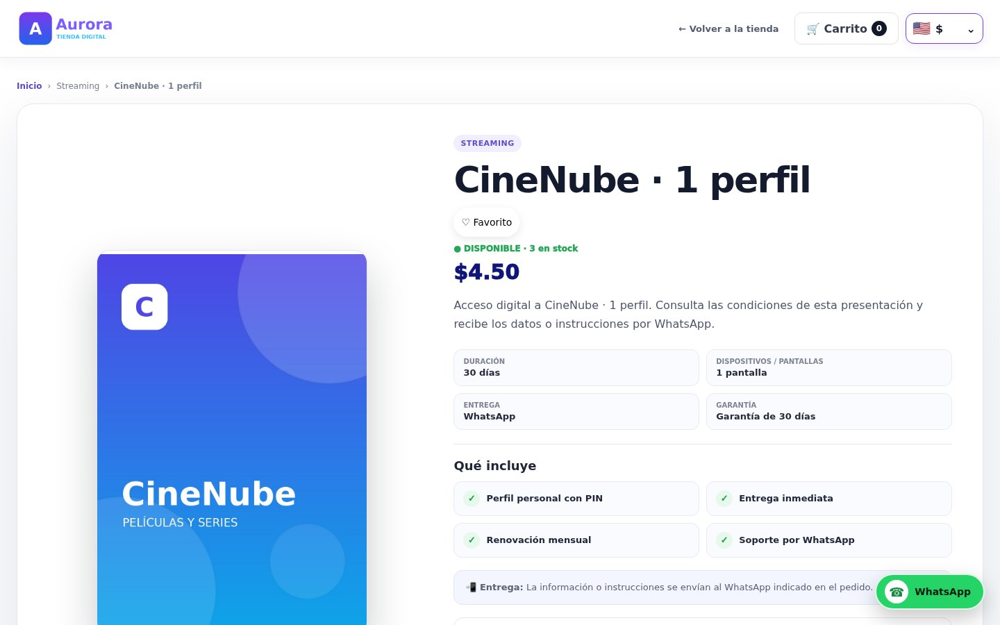 |

| La compra | El pedido entregado |
|---|---|
| 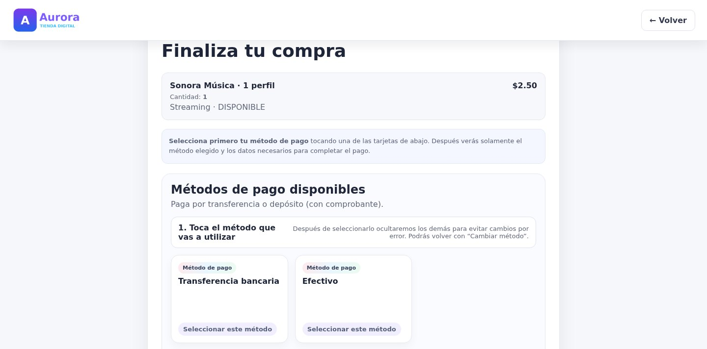 | 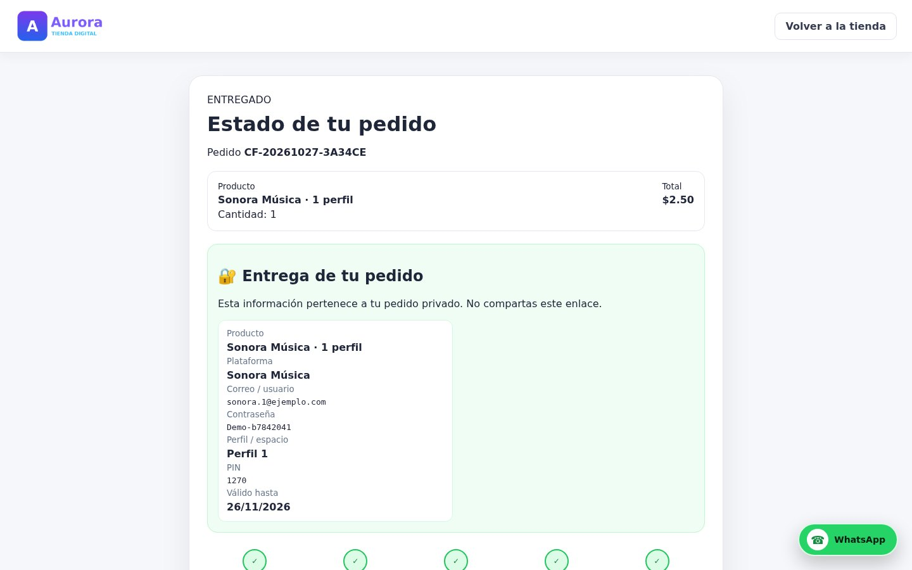 |

| El gestor en el celular | La tienda en el celular |
|---|---|
| 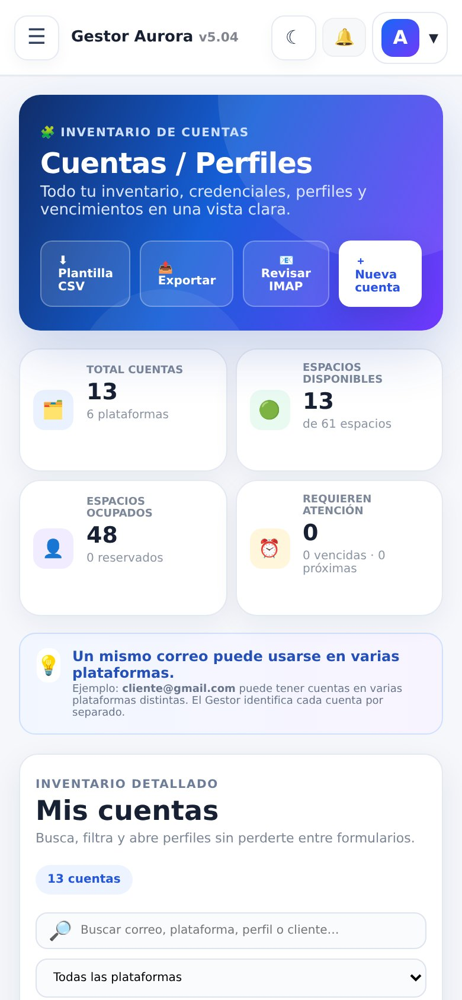 | 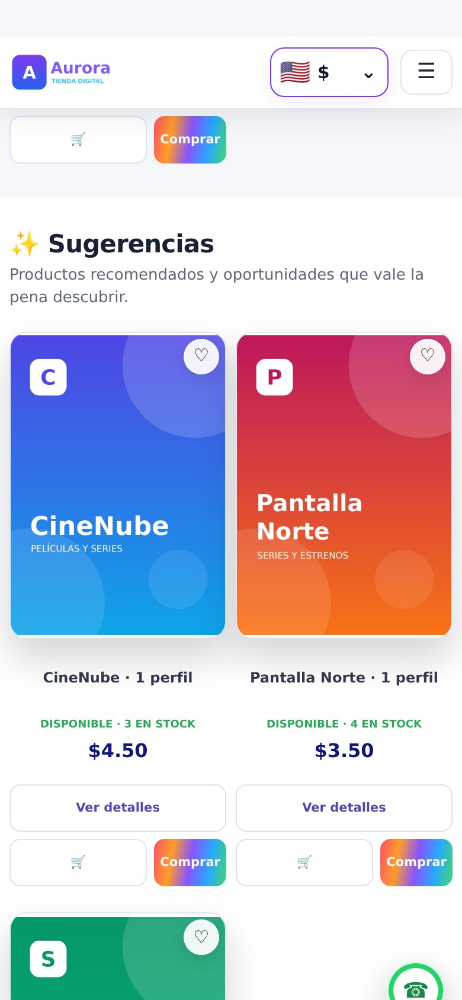 |

Instalación de demostración: plataformas, clientes y ventas inventados.

## Arquitectura

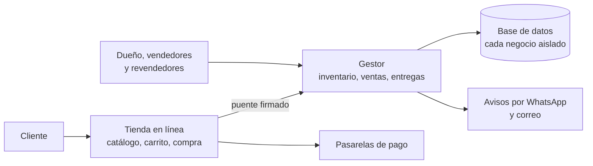

La tienda y el gestor hablan por un puente firmado con marca de tiempo: ninguno acepta
una orden que no venga del otro.

## Garantías técnicas

| Área | Qué garantiza el sistema |
|---|---|
| **Inventario** | El perfil se reserva al crear el pedido y la entrega es idempotente: un pedido no se entrega dos veces. |
| **Puente** | Tienda y gestor se comunican con firma HMAC y marca de tiempo. |
| **Pagos** | En las pasarelas automáticas se verifica la firma del aviso y se vuelve a consultar el cobro: solo se marca pagado si el importe y la moneda coinciden. Los avisos repetidos se descartan. |
| **Pedidos privados** | Cada página de pedido se abre con un enlace firmado, no adivinable por número. |
| **Aislamiento** | Cada vendedor trabaja en su propio espacio; sus clientes, inventario y ventas no se mezclan con los de otros. |
| **Acceso** | Segundo factor, límite de intentos y aviso de cada inicio de sesión. |
| **Dinero** | Ventas, costos y ganancias separados por moneda; nunca se suman monedas distintas. |

## Construido con

| Lenguaje | Dónde | Tamaño aproximado |
|---|---|---|
| **PHP** | Gestor y tienda: inventario, ventas, entregas, puente, pagos y pantallas | 26.900 líneas |
| **CSS** | La interfaz de los dos | 4.700 líneas |
| **JavaScript** | Interacción, notificaciones y app instalable | 2.100 líneas |
| **SQL** | Almacenamiento, con cada negocio aislado | — |

La barra de lenguajes de GitHub mide solo los ficheros de este repositorio, que es
documentación.

## Resultados

Cifras reales de las dos instalaciones en producción, en Centroamérica, leídas el
27-oct-2026. En producción desde mayo de 2026.

- **Más de 1.000 ventas** registradas (1.062).
- **Más de 3.000 clientes** (3.099).
- **440 cuentas** en inventario.
- **14 vendedores** con su propio espacio y ventas.

## ¿Quieres tu gestor y tu tienda?

Los instalamos con tu marca, tu moneda y tu dominio, cargamos tu inventario y tu
catálogo, y te dejamos la tienda vendiendo.

Rafael Blanco, para Kusarive Solutions LLC

- Web: [kusarive.us](https://kusarive.us)
- Correo: info@kusarive.us
- WhatsApp: [+1 407 337 0061](https://wa.me/14073370061)
- Presentación: [PDF de 16 diapositivas](presentacion/Gestor-de-cuentas-y-Tienda-presentacion.pdf)

## Novedades

- **27-oct-2026** · Publicación de la vitrina, con su presentación en PDF descargable.

Registro completo: [CHANGELOG.md](CHANGELOG.md).

© 2026 Kusarive Solutions LLC. Ver [LICENSE](LICENSE).
